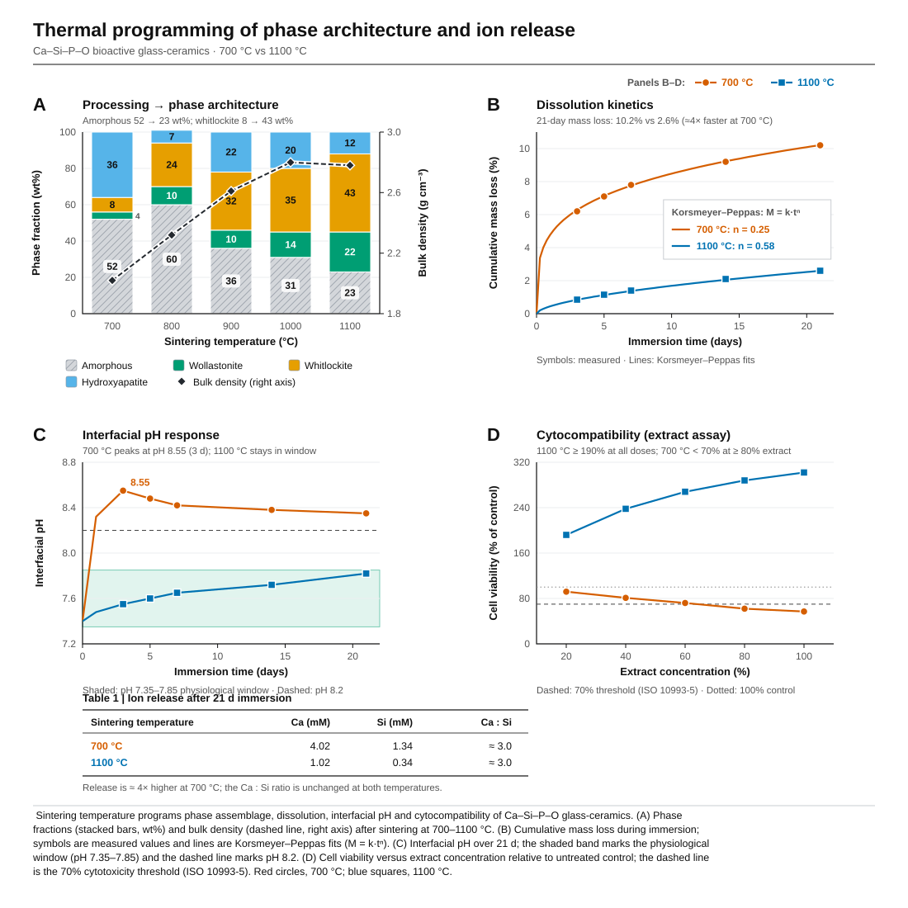
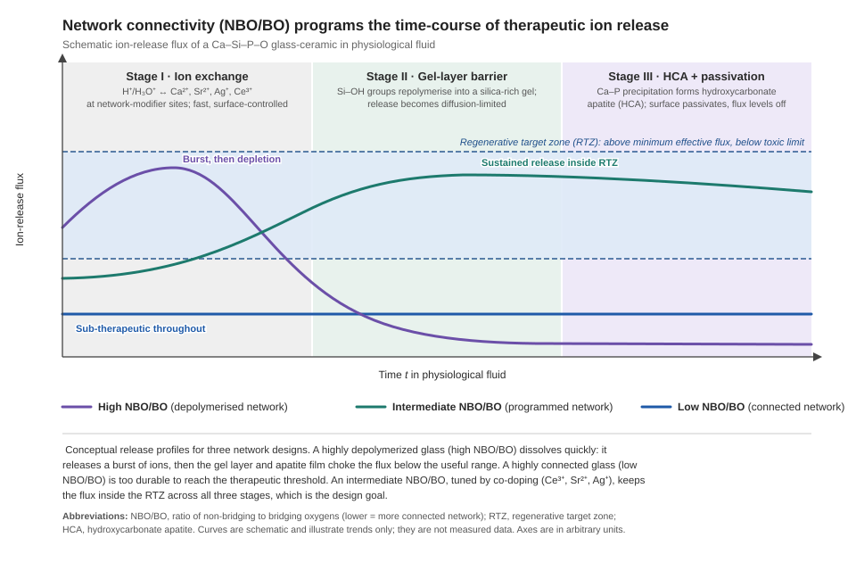
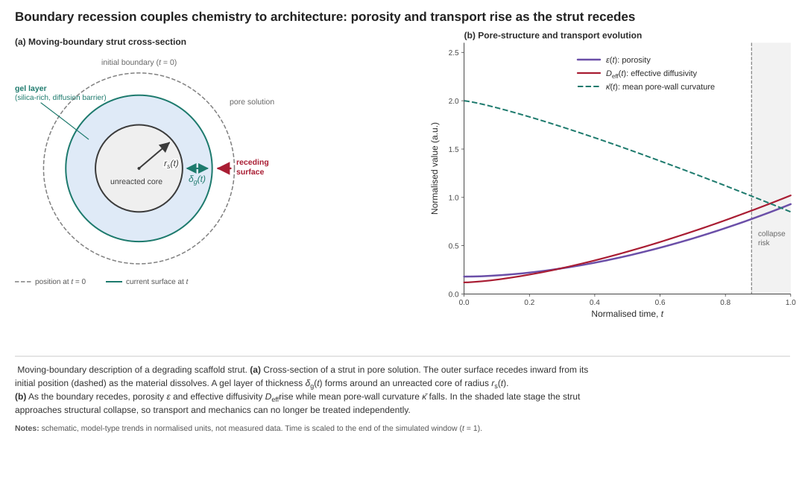
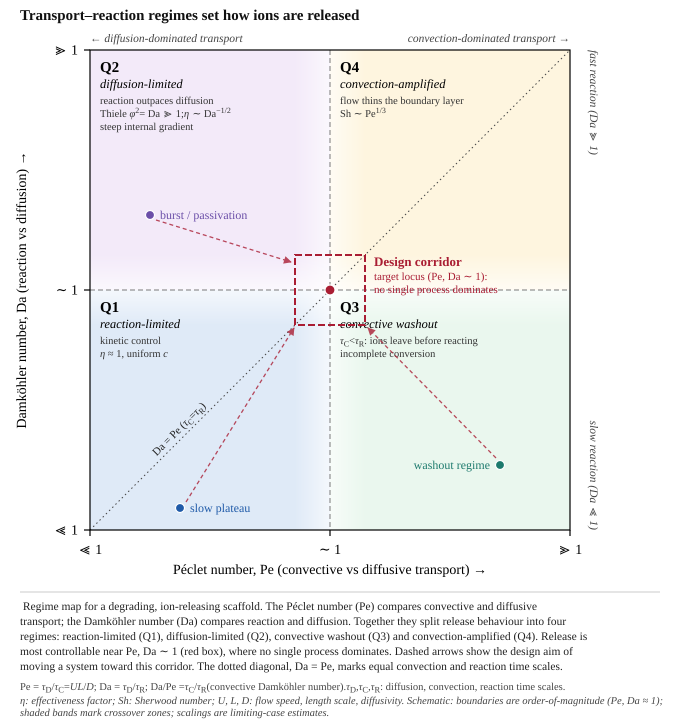
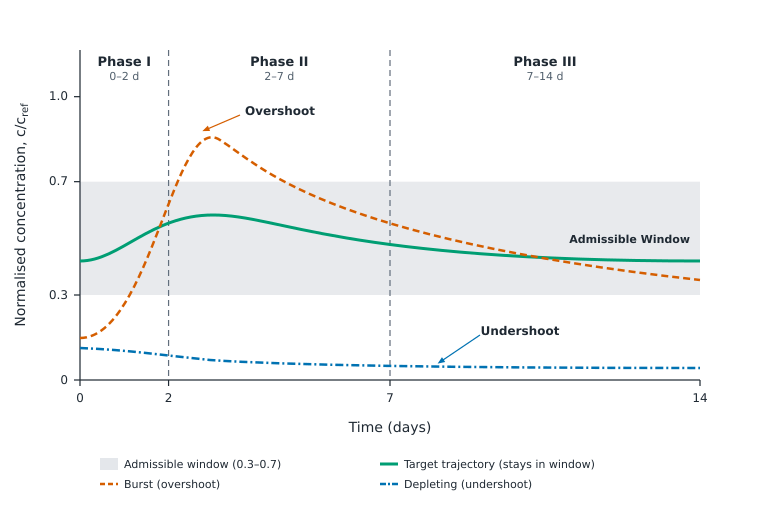

# KineticAI-AWGC

**Spatiotemporal modeling of bioactive silicate ceramics**

[](requirements.txt)
[](https://github.com/andualembelachew2/KineticAI-AWGC/actions)
[](https://colab.research.google.com/github/andualembelachew2/KineticAI-AWGC/blob/main/notebooks/01_moving_boundary_simulation.ipynb)
[](https://doi.org/10.26434/chemrxiv.15008964/v2)
[](https://doi.org/10.5281/zenodo.21759552)
[](LICENSE)

Implementation of:

> A. B. Workie, *From Static Material Design to Predictive Open-Loop Control via Chemistry–Architecture Coupling in a Moving-Boundary Reaction–Diffusion Framework* (2026). ChemRxiv, [doi:10.26434/chemrxiv.15008964/v2](https://doi.org/10.26434/chemrxiv.15008964/v2).

---

## Overview

This repository provides an open computational framework for apatite–wollastonite glass-ceramics (AWGCs). Rather than relying on static composition or endpoint bioactivity, it treats bioactivity as a coupled, time-resolved process:

$$\text{network chemistry} \rightarrow \text{ion release} \rightarrow \text{transport} \rightarrow \text{pH / supersaturation} \rightarrow \text{mineralization}$$

**Model components**

- **Solid-state kinetics.** ²⁹Si MAS-NMR Qⁿ speciation and XPS O 1s BO/NBO deconvolution are mapped to Arrhenius activation barriers.
- **Moving-boundary dissolution.** Strut recession $r_s(t)$ drives porosity $\varepsilon(t)$, tortuosity $\kappa(t)$ and effective diffusivity $D_{\mathrm{eff}}(t)$.
- **Damköhler–Péclet analysis.** Dimensionless scaling separates reaction- from transport-limited regimes and identifies a balanced design corridor ($\mathrm{Da} \sim 1$, $\mathrm{Pe} \sim 1$).
- **Regenerative Target Zone (RTZ).** A phase-scheduled admissibility envelope for multi-ion arrival: Phase I, M1 gating within 48 h; Phase II, M1→M2 transition on days 3–7; Phase III, hydroxycarbonate apatite (HCA) maturation beyond day 14.

## Governing equations

Species transport:

$$\frac{\partial C_i}{\partial t}+\nabla\cdot(\mathbf u C_i)=\nabla\cdot\left(D_{\mathrm{eff}}(t)\nabla C_i\right)+S_i-R_i$$

Dissolution-driven porosity change:

$$\frac{\partial\varepsilon}{\partial t}=k_{\mathrm{diss}}^{\circ}\,\alpha\,\beta\,\bar V_m, \qquad \beta(t)=\frac{3\,[1-\varepsilon(t)]}{r_s(t)}$$

Regime coordinates:

$$\mathrm{Da}=\frac{k_{\mathrm{diss}}^{\circ}\,\alpha\,\beta_0 L^2}{D_{\mathrm{eff}}\,C_0}, \qquad \mathrm{Pe}=\frac{UL}{D_{\mathrm{eff}}}$$

Full derivations and the equation inventory are in [`docs/`](docs).

## Figures

<p align="center">
  <br>
  <em>Kinetic Blueprint framework</em>
</p>

<p align="center">
  <br>
  <em>Chemical trajectory families</em>
</p>

<p align="center">
  <br>
  <em>Moving-boundary strut erosion and dynamic transport</em>
</p>

<p align="center">
  <br>
  <em>Damköhler–Péclet regime map</em>
</p>

<p align="center">
  <br>
  <em>Target-zone trajectory tube</em>
</p>

Additional figures and vector exports are in [`figures/exports`](figures/exports).

## Quickstart

```bash
python -m pip install -r requirements.txt
python scripts/generate_figures.py
pytest -q
```

Forward simulation with a target-range check:

```python
import numpy as np
from kineticai import admissible_tube, simulate_moving_boundary_1d

result = simulate_moving_boundary_1d(
    tmax=28.0, dt=0.05, nx=96,
    alpha=0.38, k_diss=0.016, diffusivity=0.004,
)

n = len(result["time_grid"])
trajectory = np.column_stack([
    np.full(n, 0.55), np.full(n, 0.50), np.full(n, 0.25), np.full(n, 7.70),
    result["porosity_history"].mean(axis=1),
])
lower = np.tile([0.15, 0.10, 0.05, 7.35, 0.20], (n, 1))
upper = np.tile([1.10, 1.00, 0.60, 8.20, 0.85], (n, 1))

print("Within target range:", admissible_tube(trajectory, lower, upper))
```

Interactive notebooks:
[`01_moving_boundary_simulation`](notebooks/01_moving_boundary_simulation.ipynb) ·
[`02_da_pe_regime_and_rtz_optimization`](notebooks/02_da_pe_regime_and_rtz_optimization.ipynb)

## Experimental data pipeline

```text
data/raw/*.csv → src/data_processing.py → data/processed/awgc_ml_dataset.csv → src/models.py
data/raw/*.csv → src/visualization.py  → figures/*.png
```

```bash
python src/data_processing.py
python src/models.py
python src/visualization.py
```

Transport-model fits, including Korsmeyer–Peppas analysis for the 700 °C and 1100 °C samples, are reported in [`docs/model_validation.md`](docs/model_validation.md).

**Validation status.** Model calibration and in-sample evaluation are implemented and documented. Prospective out-of-sample validation is part of the planned research program.

## Documentation

| Topic | Document |
|---|---|
| Solid-state chemistry and Arrhenius reactivity | [`01_solid_state_chemistry.md`](docs/theory/01_solid_state_chemistry.md) |
| Moving-boundary PDE and transport | [`02_moving_boundary_pde.md`](docs/theory/02_moving_boundary_pde.md) |
| Damköhler–Péclet scaling | [`03_damkohler_peclet_scaling.md`](docs/theory/03_damkohler_peclet_scaling.md) |
| Regenerative Target Zone | [`04_regenerative_target_zone.md`](docs/theory/04_regenerative_target_zone.md) |
| SciML / Bayesian validation | [`05_sciml_bayesian_pipeline.md`](docs/theory/05_sciml_bayesian_pipeline.md) |
| Manuscript source | [`trajectory_engineering.tex`](docs/trajectory_engineering.tex) |
| Equation inventory | [`equations_reference.md`](docs/equations_reference.md) |
| Experimental validation report | [`model_validation.md`](docs/model_validation.md) |
| Publication list | [`publications.md`](docs/publications.md) |

## Repository structure

```text
KineticAI-AWGC/
├── data/          Raw and processed experimental datasets
├── notebooks/     Analysis workflows and demonstrations
├── src/           Data processing, modeling and visualization scripts
├── kineticai/     Core library (moving boundary, RTZ, mechanics)
├── docs/          Manuscript, theory, equations, validation
├── results/       Validation and trajectory summaries
├── figures/       Generated figures and SVG exports
├── scripts/       Figure-generation utilities
├── tests/         Physics and numerical regression tests
├── pyproject.toml
├── requirements.txt
├── CITATION.cff
└── LICENSE
```

## Related publications

1. A. B. Workie, "From Static Material Design to Predictive Open-Loop Control via Chemistry–Architecture Coupling in a Moving-Boundary Reaction–Diffusion Framework," *ChemRxiv* (2026). [doi:10.26434/chemrxiv.15008964/v2](https://doi.org/10.26434/chemrxiv.15008964/v2). Under review in *J. Mater. Chem. B*.
2. A. B. Workie, M. B. Taye, F. P. W. Melchels and A. Mamo, "Predictive Mass-Transport Kinetics in Phase-Programmed Silicate Glass-Ceramics for Controlled Microenvironmental Engineering," *Biomater. Sci.* **14**(4), 890–902 (2026). [doi:10.1039/D6BM00997B](https://doi.org/10.1039/D6BM00997B)
3. A. B. Workie and S.-J. Shih, "A Kinetic Blueprint for Bioactive Ceramics: Programming the Bio-interface through Thermal Processing," *Ceram. Int.* **51**(3), 3410–3422 (2025). [doi:10.1016/j.ceramint.2025.11.191](https://doi.org/10.1016/j.ceramint.2025.11.191)
4. M. B. Taye, A. B. Workie and S.-J. Shih, "Rational Engineering of Mesoporous Bioactive Glass Surface Reactivity: NBO/BO Ratio Control via Synergistic Ag and Ce Co-Doping by Spray Pyrolysis," *Ceram. Int.* **52**(8), 1102–1115 (2026). [doi:10.1016/j.ceramint.2026.01.486](https://doi.org/10.1016/j.ceramint.2026.01.486)
5. A. B. Workie and M. B. Taye, "Sequential Crystallization Pathways in Apatite–Wollastonite Glass-Ceramics via Spray Pyrolysis," *RSC Adv.* **16**, 1205–1216 (2026). [doi:10.1039/d5ra08885b](https://doi.org/10.1039/d5ra08885b)
6. A. B. Workie, H. S. Ningsih and S.-J. Shih, "A Comprehensive Review on the Spray Pyrolysis Technique and Its Application to the Production of Bioactive Materials," *J. Anal. Appl. Pyrolysis* **170**, 105915 (2023). [doi:10.1016/j.jaap.2023.105915](https://doi.org/10.1016/j.jaap.2023.105915)
7. A. B. Workie, H. S. Ningsih, W.-L. Yeh and S.-J. Shih, "An Investigation of In Vitro Bioactivities and Cytotoxicities of Spray Pyrolyzed Apatite–Wollastonite Glass-Ceramics," *Crystals* **13**(7), 1049 (2023). [doi:10.3390/cryst13071049](https://doi.org/10.3390/cryst13071049)

## Citation

If you use this software, please cite the preprint and the archived release:

```bibtex
@article{workie2026trajectory,
  author  = {Workie, Andualem Belachew},
  title   = {From Static Material Design to Predictive Open-Loop Control via Chemistry--Architecture Coupling in a Moving-Boundary Reaction--Diffusion Framework},
  journal = {ChemRxiv},
  year    = {2026},
  doi     = {10.26434/chemrxiv.15008964/v2},
  note    = {Under review in Journal of Materials Chemistry B}
}

@software{workie_kineticai_awgc,
  author    = {Workie, Andualem Belachew},
  title     = {{KineticAI-AWGC: Spatiotemporal Modeling of Bioactive Silicate Ceramics}},
  year      = {2026},
  publisher = {Zenodo},
  version   = {v1.0.1},
  doi       = {10.5281/zenodo.21759552},
  url       = {https://github.com/andualembelachew2/KineticAI-AWGC}
}
```

Citation metadata is also available in [`CITATION.cff`](CITATION.cff).

## License and author

Released under the [MIT License](LICENSE).

**Andualem Belachew Workie** · [Google Scholar](https://scholar.google.com/citations?user=4_xBo44AAAAJ) · [ORCID](https://orcid.org/0000-0003-3162-4257) · [Website](https://andualemworkie.owlstown.net/)
